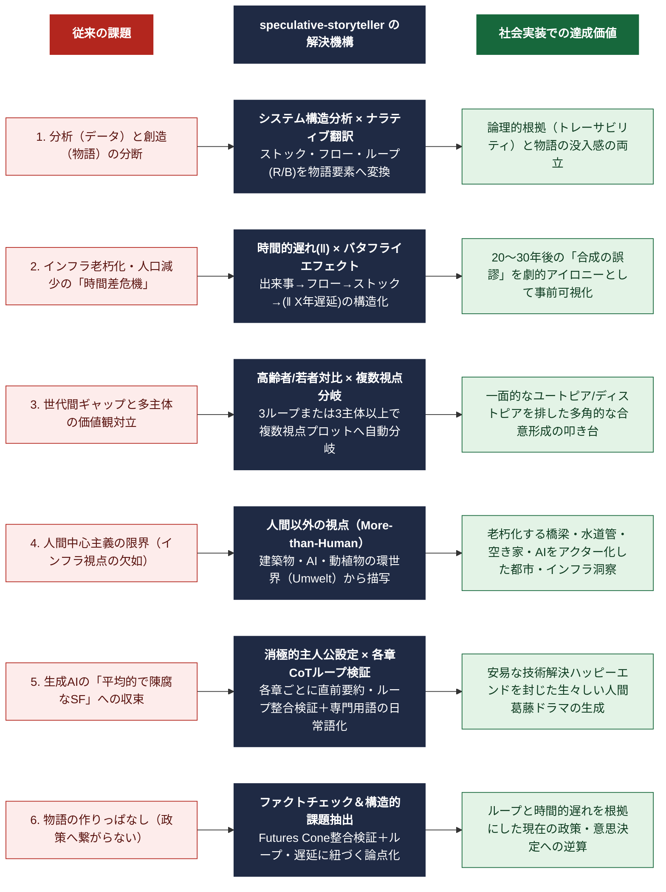

# speculative-storyteller

**System Dynamics × Speculative Fiction** —— システムダイナミクスとスペキュラティブ・デザインを統合し、現在の「弱い兆し」を増幅した未来を、因果構造に裏打ちされた物語として自動生成する [Agent Skill](https://platform.claude.com/docs/en/agents-and-tools/agent-skills/overview) です。

舞台・年代・キーワードなどの設定条件を渡すと、以下を一貫した内部ロジックで生成します。

- テーマの背後にあるシステム構造（ストック／フロー／自己強化ループ／バランス・ループ／時間的遅れ）の分析
- その因果構造を、人間・組織の葛藤／変容／崩壊／再生のドラマへ翻訳した４章構成の物語
- 生成物の前提とシステム構造・飛躍度の整合性を検証するファクトチェック

---

## 特徴

- **Futures Cone による飛躍度の明示**
  `Potential → Preposterous → Possible → Plausible → Probable → Preferable → Projected` の7段階から飛躍度を選択し、物語全体の「奇抜さ／現実らしさ」の水準をセクション冒頭に明記します。未指定時は `Plausible` を採用します。
- **システムダイナミクス → ナラティブの対応関係を固定**
  ストックは「テンションの蓄積」、フローは「日常行為」、自己強化ループ（R）は「破滅の螺旋・熱狂の連鎖」、バランス・ループ（B）は「抵抗勢力・惰性」、時間的遅れは「伏線回収・手遅れの悲劇」として一貫してマッピングされます。
- **セクション０が全セクションの根拠になる構造**
  最初に生成する「システム構造分析（変数表・因果ループ図・崩壊/転換メカニズム）」が、以降のすべての物語的判断（象徴的シーン・キャラクター設計・プロットの起承転結）の論拠として参照されます。
- **条件付きの複数視点プロット**
  因果ループが3つ以上、または主要ステークホルダーが3者以上の場合に、非対称な立場を持つ複数の視点によるプロットへ自動的に切り替わります。
- **非人間視点（More-than-Human）のセクションを標準搭載**
  動物・植物・AI・建築物・ウイルスなど、非人間アクターをシステム変数の変化を感知する独自の環世界（Umwelt）を持つ存在として描くセクションを含みます。
- **ファクトチェック・セクションを標準搭載**
  生成した前提がFutures Coneの飛躍度およびセクション０の因果構造と整合しているかを検証し、ステークホルダー別の論点と構造的課題を抽出します。

## 従来の課題に対する解決アプローチ



---

## クイックリファレンス

| 入力項目     | 必須 | 備考                                       |
| ------------ | ---- | ------------------------------------------ |
| 舞台（場所） | ◎    | 具体的な市町村名を指定、対象エリアを限定　 |
| キーワード   | ◎    | 変化の種となる概念・技術・社会現象など     |
| 年代         | △    | 未指定時は 2045 年頃                       |
| 飛躍度       | △    | 未指定時は Plausible（Futures Cone 参照）  |
| 主人公の性格 | △    | 未指定時は「変化に対して消極的」           |
| 外部資料     | △    | PDF（調査資料）・画像（風景・図表）など  |

---

## 出力構成

| # | セクション | 内容 |
|---|---|---|
| 0 | システム構造分析 | 変数表・因果ループ図（テキスト表現）・崩壊/転換メカニズム |
| 1 | 変化の兆し（Sign） | 現在起きている小さな異常・初期変化 |
| 2 | 顕在化した未来（Manifestation） | 自己強化ループによって定着した未来社会 |
| 3 | ルル３条（Tool / Rule / Role） | 未来社会を支える技術・規範・役割 |
| 4 | 象徴的なシーン（Human Perspective） | 世代間の対比による価値観の断絶 |
| 5 | 人間以外の視点（More-than-Human） | 非人間アクターの環世界からの情景 |
| 6 | バタフライエフェクト（Genesis） | 時間的遅れを軸にした起点となる出来事 |
| 7 | プロット（Character Arc） | キャラクター設計と起承転結 |
| 8 | ストーリーテリング（Story Arc） | ４章構成のプロット本文 |
| 9 | ファクトチェックと論点抽出 | 前提の整合性検証・ステークホルダー別の論点・構造的課題 |

---

## 使い方

```
舞台：○○県●●市の郊外ニュータウン
キーワード：老朽化するインフラと少子高齢化で縮む地域社会
年代：2045年
```

のように条件を伝えると、Claude が飛躍度（Futures Cone）の選択を確認したうえで、セクション０から順に生成します。特定セクションのみの修正・再生成も可能です。ただし、セクション０（変数・ループ構造）に関わる修正指示を出した場合は、セクション０が先に更新され、確認を経てから後続セクションが再生成されます。

---

## 依拠する概念と出典

このスキルは、以下の理論的枠組みを参照・応用しています。原著者・原典への謝意を込めて明記します。なお、本スキルはこれらの概念の非公式な応用であり、原著者による公認・監修を受けたものではありません。

- **The Futures Cone**
  Voros, J., *"The Futures Cone, use and history,"* The Voroscope, published 24 February 2017.
  https://thevoroscope.com/2017/02/24/the-futures-cone-use-and-history/
  飛躍度（`Potential`〜`Projected`）の7段階の分類は、この記事で述べられている枠組みに基づいています。

- **ルル３条（ルール・ロール・ツール）**
  松岡正剛「1566夜　米盛裕二『アブダクション』」千夜千冊, 2014年12月18日.
  https://1000ya.isis.ne.jp/1566.html
  同記事内でアブダクティブ・アプローチの帰結として提示されている「ルール・ロール・ツール」の三点セット（松岡正剛氏の呼称で「ルル３条」）を、本スキルのセクション３の構成原理として採用しています。

---

## ライセンス

本リポジトリ（`SKILL.md` および付属ドキュメント）は [`LICENSE`](./LICENSE) に記載の通り **CC BY** で公開しています。

上記「依拠する概念と出典」に挙げた外部の著作物は、それぞれの著作者・サイトに権利が帰属します。本リポジトリのライセンスはそれら原典の著作物自体には及びません。引用・参照にあたっては、必ずリンク先の原文をご確認ください。
